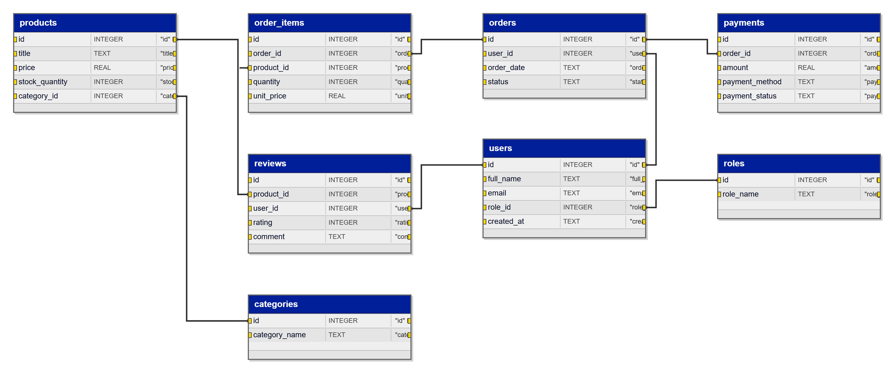

# Database Visualizer

Database Visualizer reads SQLite databases and generates an interactive HTML schema diagram.

## Features
- Shows tables, columns, types and foreign key relations
- Drag and resize table blocks
- Orthogonal connections by default
- Optional smooth connections
- Connections are routed around tables
- Export diagram to transparent PNG

## Example

## Controls
- Drag a table by its blue header.
- Resize a table using the bottom-right handle.
- Enable **Smooth connections** to round relation lines.
- Press **Export PNG** to save the diagram with a transparent background.